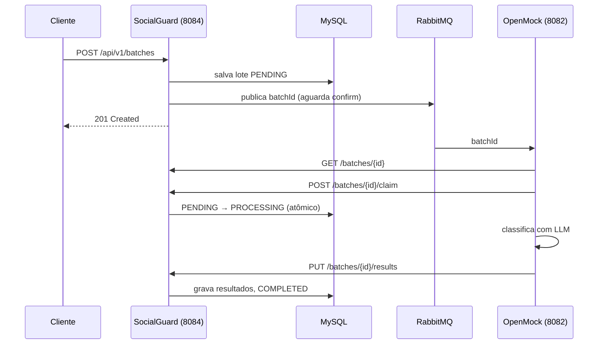
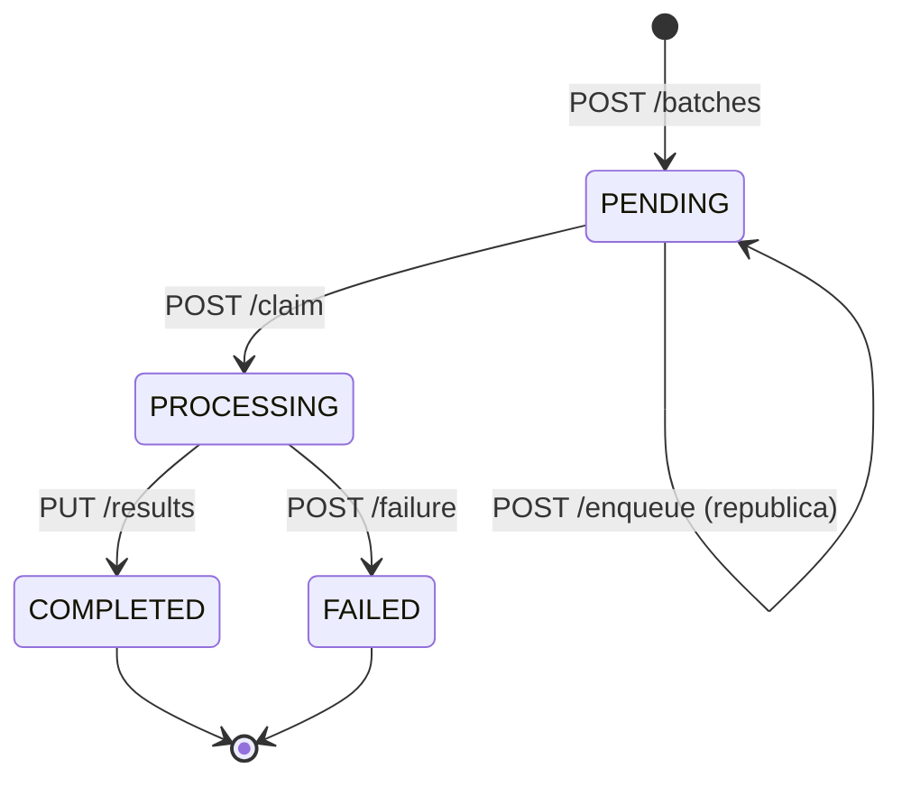

# SocialGuard

Classificador automatizado de conteúdo. O SocialGuard orquestra a classificação de comentários de redes sociais em lotes (*batch inference*), reduzindo o custo de tokens em relação a chamadas individuais ao LLM.

- [Arquitetura](#arquitetura)
- [Como executar](#como-executar)
- [Configuração](#configuração)
- [API REST](#api-rest)
- [Ciclo de vida do lote](#ciclo-de-vida-do-lote)
- [Contrato do consumidor (OpenMock)](#contrato-do-consumidor-openmock)
- [Erros](#erros)
- [Testes](#testes)
- [Proposta do projeto](#proposta-do-projeto)

## Arquitetura



**Ponto central:** o broker carrega **só o `batchId`**, não o payload. O lote já está no banco; a fila é um gatilho de trabalho, não a fonte de verdade. Isso evita mensagens grandes, permite reprocessar e dá idempotência barata.

| Pacote | Responsabilidade |
|---|---|
| `controller` | Endpoints REST (`BatchController`) |
| `service` | Regras de negócio e transições de estado (`BatchService`); publicação no RabbitMQ com *publisher confirms* (`BatchMessagePublisher`) |
| `repository` | Spring Data JPA, incluindo a reivindicação atômica `claimIfPending` |
| `domain` | Entidades `Batch` e `Comment`; enums `BatchStatus` e `InferenceResult` |
| `dto` | Contratos de entrada e saída da API (records) |
| `exception` | Exceções de negócio e mapeamento para *Problem Details* (RFC 9457) |
| `config` | Declaração de exchange, fila e dead-letter no RabbitMQ |

## Como executar

Pré-requisitos: Java 21+ e Docker.

```bash
# Infraestrutura: MySQL, phpMyAdmin, RabbitMQ, Prometheus, Tempo e Grafana
docker compose up -d

# Aplicação (porta 8084)
./mvnw spring-boot:run        # Windows: mvnw.cmd spring-boot:run
```

| Serviço | URL |
|---|---|
| API | http://localhost:8084/api/v1/batches |
| Swagger UI | http://localhost:8084/swagger-ui.html |
| Actuator / Prometheus | http://localhost:8084/actuator/prometheus |
| RabbitMQ Management | http://localhost:15672 (`aluno` / `aluno`) |
| phpMyAdmin | http://localhost:8080 |
| Grafana | http://localhost:3000 (`admin` / `admin`) |
| Prometheus | http://localhost:9090 |

O banco `social_guard` é criado automaticamente na primeira execução (`createDatabaseIfNotExist=true`, `ddl-auto=update`).

## Configuração

Os valores padrão estão em `src/main/resources/application.properties` e podem ser substituídos por variáveis de ambiente:

| Variável | Padrão | Descrição |
|---|---|---|
| `RABBITMQ_HOST` | `localhost` | Host do broker |
| `RABBITMQ_PORT` | `5672` | Porta AMQP |
| `RABBITMQ_USERNAME` / `RABBITMQ_PASSWORD` | `aluno` / `aluno` | Credenciais |
| `RABBITMQ_CONFIRM_TIMEOUT` | `5s` | Tempo máximo de espera pela confirmação do broker |
| `BATCH_EXCHANGE` | `socialguard.batch` | Exchange (direct) de processamento |
| `BATCH_QUEUE` | `socialguard.batch.processing` | Fila durável consumida pelo OpenMock |
| `BATCH_ROUTING_KEY` | `batch.process` | Routing key exchange → fila |
| `BATCH_DLX` | `socialguard.batch.dlx` | Dead-letter exchange |
| `BATCH_DLQ` | `socialguard.batch.failed` | Fila de mensagens rejeitadas |
| `BATCH_DLX_ROUTING_KEY` | `batch.failed` | Routing key da dead-letter |

Mensagens rejeitadas sem *requeue* pelo consumidor vão para `socialguard.batch.failed`.

## API REST

Base: `/api/v1/batches`. A documentação interativa (OpenAPI) fica em `/swagger-ui.html`.

| Método | Caminho | Descrição | Sucesso |
|---|---|---|---|
| `POST` | `/` | Cria o lote (`PENDING`) e publica o `batchId` na fila | `201` + `Location` |
| `GET` | `/?companyId=&status=` | Lista lotes; filtros opcionais | `200` |
| `GET` | `/{id}` | Detalha um lote e seus comentários | `200` |
| `POST` | `/{id}/enqueue` | Republica um lote `PENDING` na fila | `202` |
| `POST` | `/{id}/claim` | Reivindica atomicamente: `PENDING` → `PROCESSING` | `200` |
| `PUT` | `/{id}/results` | Grava as classificações: `PROCESSING` → `COMPLETED` | `200` |
| `POST` | `/{id}/failure` | Marca falha permanente: `PROCESSING` → `FAILED` | `200` |
| `PUT` | `/{id}` | Atualização administrativa parcial (campos nulos são ignorados) | `200` |
| `DELETE` | `/{id}` | Remove o lote e seus comentários | `204` |

### Criar lote

```http
POST /api/v1/batches
Content-Type: application/json

{
  "companyId": "company-1",
  "llmModel": "gpt-4",
  "comments": [
    { "postId": "1", "commentId": "1", "name": "id labore ex et quam laborum",
      "email": "Eliseo@gardner.biz", "body": "laudantium enim quasi est quidem magnam..." }
  ]
}
```

Validações: `companyId` obrigatório; `comments` não vazio; `body` de cada comentário obrigatório.

Resposta `201 Created`:

```json
{
  "batchId": "3f6c1a2e-8a5b-4c1d-9f0e-2b7d4e6a8c10",
  "companyId": "company-1",
  "createdAt": "2026-10-12T10:00:00",
  "updatedAt": "2026-10-12T10:00:00",
  "completedAt": null,
  "status": "PENDING",
  "tokensConsumed": 0,
  "llmModel": "gpt-4",
  "comments": [
    { "id": 12, "postId": "1", "commentId": "1", "name": "id labore ex et quam laborum",
      "email": "Eliseo@gardner.biz", "body": "laudantium enim quasi est quidem magnam...",
      "createdAt": null, "updatedAt": null, "inferenceResult": null }
  ]
}
```

### Reivindicar lote

`POST /api/v1/batches/{id}/claim` → `{ "claimed": true, "status": "PROCESSING" }`

`claimed` é `true` apenas para o primeiro consumidor; chamadas seguintes recebem `false` com o status atual.

### Gravar resultados

```http
PUT /api/v1/batches/{id}/results
Content-Type: application/json

{
  "comments": [ { "id": 12, "inferenceResult": "SPAM" } ],
  "tokensConsumed": 1500,
  "llmModel": "gpt-4"
}
```

- `id` é o identificador interno do comentário retornado pelo `GET`.
- `inferenceResult`: `OK`, `SPAM`, `VIOLENT` ou `SEXUAL`.
- Cada comentário do lote deve aparecer **exatamente uma vez** (sem faltar, sobrar ou repetir).
- `tokensConsumed` (≥ 0) e `llmModel` são opcionais; se omitidos, mantêm os valores atuais.
- Reenviar os mesmos resultados para um lote já `COMPLETED` é idempotente; resultados diferentes retornam `409`.

## Ciclo de vida do lote



Transições fora desse fluxo retornam `409 Conflict`. A exceção é o `PUT /{id}`, usado para recuperação operacional, que altera o status sem validar a transição.

## Contrato do consumidor (OpenMock)

O OpenMock (porta `8082`) é um consumidor externo da fila `socialguard.batch.processing`. A mensagem tem como corpo apenas o `batchId` em texto simples. Para cada mensagem, o consumidor deve:

1. Consultar `GET /api/v1/batches/{id}` para carregar os dados que não estão na mensagem.
2. Chamar `POST /api/v1/batches/{id}/claim`. Só processar quando a resposta tiver `claimed: true`; quando `false`, confirmar (*ack*) a mensagem sem processar de novo.
3. Persistir todas as classificações com `PUT /api/v1/batches/{id}/results`.
4. Em falha permanente, chamar `POST /api/v1/batches/{id}/failure`.
5. Limitar retries transitórios e confirmar a mensagem somente depois de persistir o resultado ou reconhecer que o lote já foi reivindicado/concluído.

### Recuperação

- **Broker indisponível na criação:** o `POST` retorna `503` com o `batchId` no corpo. O lote continua `PENDING`; após a recuperação do broker, reenfileire com `POST /api/v1/batches/{id}/enqueue`.
- **Timeout de confirmação:** o resultado é ambíguo (a mensagem pode ter sido entregue). Mensagens duplicadas são seguras graças à reivindicação atômica.
- **Lote abandonado em `PROCESSING`:** volte o estado para `PENDING` com `PUT /api/v1/batches/{id}` (`{ "status": "PENDING" }`) e reenfileire.

## Erros

Os erros seguem o formato *Problem Details* (`application/problem+json`):

```json
{ "type": "about:blank", "title": "Conflict", "status": 409,
  "detail": "Somente lotes PROCESSING podem receber resultados: 3f6c...", "instance": "/api/v1/batches/3f6c.../results" }
```

| Status | Causa |
|---|---|
| `400 Bad Request` | Falha de validação do corpo; `detail` lista `campo: mensagem` |
| `404 Not Found` | Lote inexistente |
| `409 Conflict` | Transição de estado inválida, resultados inconsistentes com o lote ou divergentes de um lote concluído |
| `503 Service Unavailable` | Falha ao publicar no RabbitMQ; inclui a propriedade `batchId` |

## Testes

```bash
./mvnw test                                  # suíte completa
./mvnw test -Dtest='Batch*Test'              # apenas testes unitários (sem infraestrutura)
```

| Classe | Escopo |
|---|---|
| `service/BatchServiceTest` | Regras de negócio e transições de estado, com repositório e publisher mockados |
| `service/BatchMessagePublisherTest` | Publicação no RabbitMQ: ack, nack, mensagem não roteada, timeout e interrupção |
| `controller/BatchControllerTest` | Camada web (`@WebMvcTest`): rotas, códigos HTTP, validação e mapeamento de exceções |
| `domain/BatchTest` | Relacionamento lote–comentários e callbacks JPA |
| `SocialGuardApplicationTests` | Sobe o contexto completo; **requer MySQL em execução** (`docker compose up -d db`) |

---

## Proposta do projeto

SocialGuard é um software capaz de orquestrar fluxos de classificação de posts escritos de redes sociais, para moderar conteúdos impróprios. Validações manuais e individuais são custosas e não escalam. Chamadas individuais a LLMs para cada post geram custo alto de token. Necessidade de padronização dos registros e auditoria das decisões de moderação.
O principal objetivo é reduzir custos de operação e consumo de tokens. Isso pode ser obtido, utilizando-se chamadas em lote às APIs dos modelos de IA generativa.

O orquestrador será responsável por:
- Receber lotes de posts de clientes;
- Agrupá-los em prompts otimizados (batch inference);
- Submeter à API do LLM, garantindo resiliência às solicitações;
- Persistir status, resultados e métricas de custo;
- Disponibilizar relatórios para o cliente.

### Principais funcionalidades

**Cadastro de clientes**
- cada usuário poderá submeter lotes de posts
- visualizar o status das análises
- obter o resultado das análises

**Submissão de um lote de posts**
- envio do lote à API do modelo de LLM

**Registro e enfileiramento**
- criação de registro de status (PENDENTE, PROCESSANDO, CONCLUÍDO, FALHOU)
- registro do lote no banco de dados

**Cálculo do custo da classificação**
- gerenciar o consumo de tokens para inferência em lote
- estimar economia gerada

**Persistência e Notificação**
- classificar posts em categorias (ok, spam, violento, sexual)
- notificar o usuário da conclusão de uma análise (opcional)

### Aspectos técnicos

CRUD dos arquivos de lote dos posts.

1. **Criação de filas de processamento com Spring AMQP / RabbitMQ.**
   Desacoplar a submissão do lote via APIs REST (Spring MVC) do processamento assíncrono (chamada ao LLM), garantindo escalabilidade horizontal e controle de concorrência com Spring Boot.
2. **Gerenciamento do consumo de tokens e persistência com Spring Data.**
   Medir, controlar e otimizar o consumo de tokens, registrando métricas e persistindo relatórios via Spring Data JPA para comprovação da economia.
3. **Logs e observabilidade com Spring Boot Actuator.**
   Garantir a observabilidade técnica e infraestrutural utilizando Spring Boot Actuator e Micrometer para coletar métricas de saúde da aplicação, vazão de filas e estado da resiliência, enquanto os KPIs e métricas de negócio são fornecidos por endpoints REST dedicados consultando o banco de dados via Spring Data JPA. Visualização no Grafana.
4. **Resiliência na integração com LLMs usando Resilience4j.**
   Garantir a disponibilidade contínua através de padrões de Retry e Circuit Breaker (Resilience4j integrado ao Spring) para contornar oscilações, rate limits e degradações nos provedores de LLM.